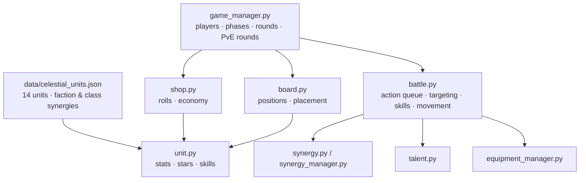

# AutoBattle Engine · 天界之战

The core logic of an auto-battler game with a Chinese-mythology roster, written in plain Python. It covers units, an 8×8 board, a shop and economy, faction and class synergies, talents, equipment and a turn-based battle simulator. All of it is covered by console-only unit and integration tests.


> **Status:** engine only. There is no playable UI or game entry point yet; the systems are exercised through tests and per-module demos.

## Architecture



## Highlights

- **Deterministic, testable systems.** Each module has a small API (`setup_battle`, `start_battle`, `place_unit` …) and is tested in isolation, plus a full game-loop simulation in `tests/test_simulation.py`.
- **Battle loop.** Each round builds an action queue, picks attack / skill / move per unit by range and target, applies skill effects and checks end conditions, then returns a `BattleResult` with the winner, round count, damage and skill-use statistics.
- **Data-driven roster.** Units and synergies live in JSON, so balance changes don't touch code.
- **No third-party dependencies.** Standard library only.

## Tech Stack

Python 3 (standard library: `dataclasses`, `enum`, `typing`, `json`, `random`) · `unittest` / `pytest`

## Getting Started

```bash
git clone https://github.com/Willa1m/AutoBattle_Game.git
cd AutoBattle_Game

python -m unittest discover -s tests      # or: python -m pytest
python -m core.battle                     # demo battle printed to the console
```

## Project Structure

```text
core/
├── unit.py               # unit stats, star levels, skills
├── board.py              # board positions and placement
├── shop.py               # shop rolls and economy
├── synergy.py            # faction / class synergy rules
├── synergy_manager.py
├── talent.py             # talents
├── equipment_manager.py  # equipment
├── class_attr_manager.py
├── battle.py             # battle simulator
└── game_manager.py       # players, phases, rounds
data/celestial_units.json # unit and synergy definitions
tests/                    # unit and integration tests (63)
```

The Chinese design document (`天界之战：中国神话自走棋项目计划书（TRAE适配版）.md`) and `KEYS.md` record the planned features and development notes.

## Results / Learnings

- 63 tests pass with both `unittest` and `pytest` (checked when this README was written).
- Writing the battle loop as "build a queue → decide → apply → check end" made it much easier to test edge cases one step at a time.
- Next steps: a game entry point and CLI, more units, and balance tuning driven by simulation.

## 中文说明

这是一个以中国神话为题材的自走棋核心引擎，只用 Python 标准库编写，目前还没有可玩的界面或入口程序。

已实现的部分：

- 棋子属性与星级；
- 8×8 棋盘；
- 商店与经济系统；
- 阵营与职业羁绊；
- 天赋、装备，以及回合制战斗模拟。

单位和羁绊数据放在 `data/celestial_units.json` 里，调整数值不需要改代码。所有核心功能都通过控制台测试验证，目前 63 个测试全部通过。

运行 `python -m unittest discover -s tests` 执行测试；运行 `python -m core.battle` 可以在控制台看到一场演示战斗。
